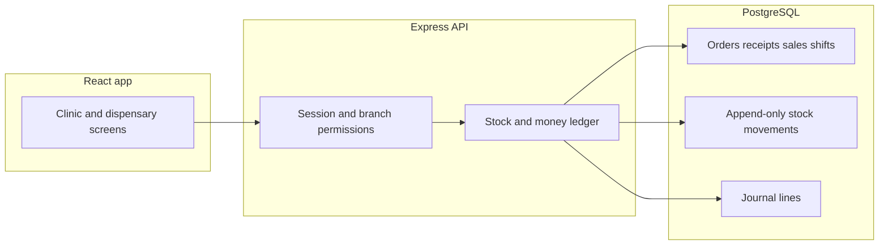

# Full pharmacy ERP on a shared server

Research date remains **23 Oct 2026** in [docs/product/market-research.md](docs/product/market-research.md). You chose the widest product and a real database. The sales counts do not support launching that scope on CodeCanyon. They do say which workflows have to be true before multi-branch, ecommerce, or statements are worth building.

## What the market supports

- Clinic scripts sell in the hundreds to low thousands (Smart Hospital 2,036 at $89, KiviCare Pro 1,229 at $149, Doxe 514 at $39, InfyCare 403 at $49). Standalone pharmacy POS sells more slowly (Medicine Care 146 at $60, updated 19 Oct 2026; Medix 164 at $75, last update 2023; Acnoo 119 at $29). The clinic-plus-pharmacy add-on, KiviCare Pharma, has **10 sales at $89**.
- New Envato Code author accounts are paused (Envato article updated 25 Sep 2026). This owner is not a Code author. Treat this as a private multi-user product, not a marketplace zip. A $59 script price is a developer price. Bangladesh operators on vendor pages pay a monthly fee, from Bisnesy at ৳499 to ShifaSoft’s hospital plan at ৳8,000.
- Buyers already get batches, expiry, and FEFO from Medicine Care. Bisnesy documents strip-or-loose sale, supplier credit, and a 7-day expiry alert, and states it stores no prescriptions. ShifaSoft advertises prescription-linked dispensing inside the hospital plan. The gap to design for is one trail from prescription line to batch movement to invoice line, plus the counter, supplier, and branch books those vendors split apart.
- Do not bundle a national catalogue. Bisnesy states 26,000+ brands and ChamberBD states 23,429 medicines. Those databases are theirs. The product stores medicines the operator imports from a file they own.

## What is already in this repo

The UI is a Vite + React demo. [server.ts](server.ts) serves that UI plus Gemini dosage help and an in-memory WebRTC room. Clinical and stock data live in `localStorage` inside [src/context/ClinicContext.tsx](src/context/ClinicContext.tsx).

Keep and rewire these screens: [src/components/dispensary/DispensaryManager.tsx](src/components/dispensary/DispensaryManager.tsx), dispense, goods receipt, batches, barcode scan and labels, billing, and the domain types in [src/types/index.ts](src/types/index.ts).

Do not copy these demo behaviors onto the server:

- `quickRestockBatch` increases a batch with no receipt.
- Supplier is a typed name, not a ledger.
- Two browsers do not share stock, and client-made ids collide.
- A retried click can dispense twice. The comment in `createGoodsReceipt` says “idempotent” but the handler is not.

Rules to keep, from `processDispense`: saving a prescription does not change stock; expired, quarantined, and blocked batches cannot be issued; dispensed quantity may be below prescribed quantity; one invoice carries the consultation fee and the medicine lines once; quantities are integer base units (strip and loose tablet).

## Architecture

PostgreSQL is the stock book. Extend the existing Express process in [server.ts](server.ts) with a versioned API. Prisma owns migrations. The React app becomes a client of that API. Docker Compose runs Postgres and the app. Synthetic seed data replaces the current mock files and is labeled synthetic.

Every quantity change is an append-only movement in one database transaction: goods receipt, dispense, walk-in sale, sale return, purchase return, count adjustment, expiry write-off, or inter-branch transfer. Batch quantity is the sum of movements. A unique key on the client request id makes a retry a no-op. Expired, quarantined, and blocked lots are rejected in the same transaction. Default lot selection is first-expiry-first-out; the dispenser or cashier may pick another valid lot. One sale line takes one lot.

Money uses the same transaction. A small chart of accounts is posted from day one, even though the statement screens come later: cash, bKash, Nagad, card, patient receivables, supplier payables, inventory, consultation revenue, medicine sales, cost of goods, and returns. Consultation revenue and medicine sales stay separate. Recorded wallet references only. No live bKash, Nagad, or card gateway in this plan.

Tenancy is organization, then branch. Users have the existing roles in [src/types/index.ts](src/types/index.ts) plus assignable permissions for purchasing, cashier, stock count, and branch transfer. Stock, sales, and purchases belong to one branch. An organization admin can read all branches.

## Delivery order

The ERP modules you selected are all in scope. They land in this order so later modules post into the same ledger.

1. **Shared clinic and dispensary.** Auth, branch, patients, doctors, appointments, queue, prescriptions, medicines, batches, goods receipts, partial dispense, consolidated invoice, payments, audit. Prescription save still does not move stock. Remove quick restock. This replaces `localStorage`.
2. **Procurement.** Supplier master, purchase orders, partial receipts against an order, supplier credit and payments, purchase returns that remove stock and reduce payables.
3. **Counter and shifts.** Walk-in sale with or without a patient, barcode lookup already sketched in `findInventoryByBarcode`, sale returns, cashier open and close with counted cash. The dispensary queue stays a different screen from the walk-in till.
4. **Stock control.** Physical counts with a variance movement, expiry write-off, quarantine. Near-expiry and low-stock lists per branch. No silent edit of on-hand quantity.
5. **Multi-branch.** Second branch, branch-scoped stock, transfer out and transfer in as two movements. Reports can filter by branch.
6. **Statements.** Trial balance, income statement, inventory valuation, supplier and patient aging, drawn only from the journal. No second set of totals typed into a report.
7. **Catalogue and storefront.** CSV import the operator supplies, with brand, generic, form, strength, company, units per pack, and barcode. Rejected rows are reported, not half-imported. The public storefront creates the same sale document as the till, with channel `ecommerce`, and cannot sell an invalid lot. Payment on the storefront is recorded as due or as a manual reference until a gateway is a separate decision.

## Out of this build

- Copying Bisnesy, ChamberBD, or any other vendor’s medicine list.
- Claims of DGDA, HIPAA, or GDPR compliance. Those rules are not assessed.
- Live payment gateways, SMS, native apps, laboratory, and inpatient beds.
- A license server that hides patient or stock history when it cannot be reached.
- CodeCanyon packaging.

## Acceptance checks

- Two signed-in browsers: a doctor saves a prescription and the on-hand quantity does not change; a dispenser issues part of a line and only that lot decreases; the invoice shows the visit fee and the medicine once.
- A second click with the same request id does not move stock again.
- An expired lot cannot be dispensed, sold at the counter, or sold online.
- A partial supplier delivery increases stock only for the received packs and leaves the rest on the order.
- A strip and two loose tablets decrement base units by `unitsPerPack + 2`.
- Branch A’s sale does not change branch B’s quantity. A transfer does, on both sides.
- The income statement’s medicine sales equal posted sale lines, not a separate counter.