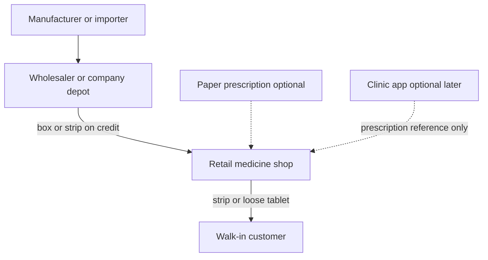

# Standalone medicine shop: market and structure

Research date for the new pass: **24 Oct 2026**. The clinic-plus-dispensary decision in [docs/product/market-research.md](docs/product/market-research.md) stays as written. This pass is the other shelf: a medicine shop that sells at its own counter, with the clinic as an optional later handoff.

After approval, write the findings into [docs/product/standalone-medicine-shop.md](docs/product/standalone-medicine-shop.md) and add a short pointer in [docs/roadmap.md](docs/roadmap.md). No schema, no UI, no change to [src/context/ClinicContext.tsx](src/context/ClinicContext.tsx).

## What the market is

Three different markets get mixed together in pharmacy software briefs. Only the first two are buyers for this product.

- **The medicine trade in Bangladesh.** The WHO Bangladesh medical products profile (PDF filename 2025, read 24 Oct 2026) states a pharmaceutical market of about US$ 2.7 billion, 264,908 retail pharmacies, 2,695 wholesalers or distributors, 275 manufacturers, 351 importers, and 117 price-controlled medicines with a maximum retail price. That figure is the drug market, not software spend. Shop-software revenue is not published.
- **Software sold to those shops.** Hosted Bangladesh products charge a monthly fee. CodeCanyon sells a one-time PHP script to developers. Those are the two software shelves.
- **Out of this analysis.** US and EU chain-pharmacy systems, and the clinic or hospital script shelf (Smart Hospital, KiviCare, InfyCare). A clinic add-on is a third, weak shelf: KiviCare Pharma has 10 sales at $89 in the 23 Oct research.

Outlet counts conflict and must stay unreconciled. Do not average them.

- WHO profile: 264,908 retail pharmacies.
- Times of Bangladesh, citing DGDA, article date not on the fetched text: 226,118 registered pharmacies, nearly half without a valid authorization, about 100,000 with licences expired for 10 to 15 years, and a DGDA-source estimate of about 250,000 unlicensed drugstores.
- A 2020 supply-chain paper: 117,354 registered allopathic retail outlets and an estimate of about 200,000 including unlicensed shops.

## How a shop actually sits in the trade

The shop buys from a wholesaler, often on credit and often as a partial delivery. It sells a strip or loose tablets for cash, a recorded bKash or Nagad reference, or customer credit. A paper prescription may be in the customer’s hand. Bisnesy’s pharmacy page states that its product stores no prescriptions and no patient records, and does not file with the DGDA. That is the default standalone shop. Medicine Care, on CodeCanyon, also converts a typed prescription into a sale. Both behaviors exist. The shop does not need the clinic’s queue, notes, or consultation fee.

DGDA’s accreditation guideline, authorized 2 June 2024, splits two outlet types. A Model Pharmacy needs at least 300 square feet, a Grade A pharmacist, and a computer running DGDA’s own pharmacy software or a commercial one. A Model Medicine Shop needs at least 120 square feet and a Grade B or C dispenser. A computer is described as better for the medicine shop and not mandatory. The functions named for that software are purchase, sales, profit, stock in, stock out, and an expired-medicine alert. A Madaripur DGDA page lists a new allopathic retail licence at ৳2,500 in a municipal area and ৳1,500 outside it. This product must not claim DGDA, model-pharmacy, or ADLRS compliance. The guideline only shows which day-to-day jobs a serious shop is told to run on a computer.

## Software shelves, read 24 Oct 2026

CodeCanyon, same figures as 23 Oct where the pages still showed them:

- Medicine Care, $60, 146 sales, last update 19 Oct 2026. POS, batches, expiry, FEFO, purchases, returns, prescription converted to a sale, ecommerce, cash and due. Strongest current script. Its own comments, from the 23 Oct pass, show unit edits, update packaging, and a licence check that can lock an offline install.
- Medix, $75, 164 sales, last update 23 Oct 2023. Broad POS, purchases, ledgers, and statements. Three years without an update.
- Acnoo Pharmacy SaaS, $29. The item text showed 106 sales and a 22 Jan 2026 update. A portfolio card showed 119 sales. Cite both. A separate web add-on is also $29. The portfolio cards disagreed between 71 and 63 sales. Flutter app plus admin, not a clinic record.

Bangladesh hosted products. Vendor pages, not audits. No sales counts on the pages opened.

- Bisnesy is a general shop system with a pharmacy mode. The pharmacy page still says 26,000+ brands, batch and expiry, strip or tablet, a 7-day expiry alert, and no prescriptions. The public price ladder on 24 Oct is Starter ৳499, Growth ৳999, Pro ৳1,499, Enterprise ৳5,000 per month. The 6-month price page shows ৳415, ৳832, ৳1,248, and ৳4,167. Pro is where counters, shifts, branches, and an online store appear. Enterprise is where wholesale price, landed cost, and transfers appear.
- Riser POS Pharmacy, Dimdul, page dated as prices checked 7 Oct 2026: Startup ৳1,000, Plus ৳2,000, Pro ৳2,500 per month, plus ৳5,000 setup. Caps of 200, 500, and 1,500 products. A shop that stocks thousands of brands outgrows the cheap tiers on that cap alone.
- PharmacyOS, vendor pricing page: Lite ৳1,500, Pro ৳5,000, Chain ৳15,000 per month, with a storefront and bKash and Nagad. Not in the 23 Oct note.
- ShifaSoft’s pharmacy page is prescription-linked dispensing inside a hospital suite. Diagnostic ৳3,000 and Hospital ৳8,000 per month, VAT extra. There is still no standalone shop price on that page.

What the prices say: a shop owner is shown ৳499 to about ৳2,500 a month for one counter. A $59 script is a developer price, already recorded in the clinic research. CodeCanyon pharmacy scripts sell in the low hundreds over several years, behind clinic scripts in the hundreds to low thousands. Envato is still not opening new Code author accounts (article updated 25 Sep 2026). This owner is not a Code author.

## Shop structure

One shop, one counter, one stock book. Every quantity change is an append-only movement. On-hand quantity is the sum of movements. A repeated click with the same request id does not move stock twice. Expired, quarantined, and blocked lots cannot be sold. The seller may override first-expiry-first-out with another valid lot. One sale line takes one lot.

Modules, in the order a shop feels them:

1. **Shop and staff.** Owner, cashier, and purchase clerk as permissions. One branch. Bangla and English. Currency and time zone in settings.
2. **Catalogue.** Brand, generic, form, strength, company, tablets per strip, barcode, MRP, and the shop’s own selling price. The till uses the shop price. MRP stays on the record because the WHO profile says a maximum retail price exists. The operator imports a CSV they own, or types a missing brand. Bisnesy’s 26,000 and ChamberBD’s 23,429 are not copied.
3. **Parties.** Suppliers and walk-in customers, with a phone number and a running due. This is not a patient chart.
4. **Purchasing.** Supplier bill, batch, expiry, cost, and credit. A partial delivery increases stock only for the packs received. Purchase returns remove stock and reduce the supplier due.
5. **Counter.** Search by brand or generic, barcode when the pack has one, sell a strip or loose tablets as integer base units, discount, and split tender across cash, bKash, Nagad, and due. The wallet entry is a recorded reference. No live gateway.
6. **Returns and the drawer.** Customer returns put stock back on the same lot. A shift opens and closes against counted cash.
7. **The shelf.** Low stock, expiry inside 7 days, physical count as a variance movement, expiry write-off, quarantine. No silent edit of on-hand quantity.
8. **The books a owner opens.** Day sales, profit from the cost of the lots that left, stock value, customer dues, supplier dues. Profit is not a second number typed beside the till.
9. **Optional paper prescription.** A sale can start from lines the cashier types off a paper script: doctor name, brand, prescribed quantity, dispensed quantity. Saving those lines does not itself change stock. The sale does. The shop still sells with no script.
10. **Optional clinic handoff, later and separate.** The clinic sends a prescription reference and lines. The shop returns what was issued, the lot, and the price. The clinic may put those lines on its own invoice. The shop keeps selling when no clinic is connected.

Deferred until a shop asks: a second branch and transfers, a wholesale price list, an online order that creates the same sale, cashier-only versus owner reports, and full trial balance. Bisnesy already gates branches, shifts, and the online store behind Pro, and wholesale behind Enterprise. Leading with those modules copies a ladder the sales evidence does not require.

## What this changes from the clinic plan

[pharmacy_erp_plan_26513fbb.plan.md](.cursor/plans/pharmacy_erp_plan_26513fbb.plan.md) builds pharmacy inside the clinic server and puts the consultation fee and the medicine on one invoice. That remains the shape for an in-house dispensary. A standalone shop does not have a consultation, a queue, or a patient. Its invoice is the counter memo. The shared rules worth keeping are the stock rules already in `processDispense`: stock moves on receipt and on issue, prescribed quantity and dispensed quantity stay separate, and expired or blocked lots are refused.

## Decision

No-Go for CodeCanyon, and no-Go for starting a build from this document. The shop shelf is real, and it is already served by Bisnesy at ৳499 a month and by Medicine Care at $60 with FEFO on the listing. A later private build for one named shop would be a new approval, after conversations with shop owners about yesterday’s supplier bill, a strip opened for two tablets, a customer due, and an expired box. The interview guide in the clinic research is the clinic version of that conversation. It does not by itself validate a retail shop.
